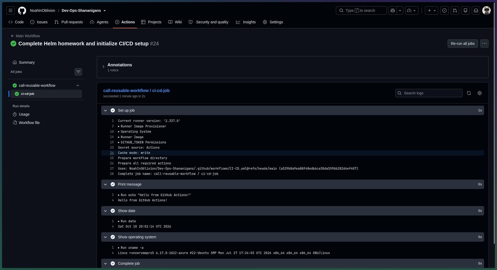

# Session 16: CI/CD & GitHub Actions Pipeline

This project demonstrates a production-grade CI/CD pipeline built with GitHub Actions for automated linting, testing, Docker image building, and deployment verification.

---

## 1. CI vs CD Concepts

| Term | Full Form | Core Responsibility |
|---|---|---|
| **CI** | Continuous Integration | Automatically builds code, runs tests, and checks code quality on every push/PR to detect bugs early. |
| **CD** | Continuous Delivery / Deployment | Automatically packages artifacts and deploys the tested code to staging/production environments. |

---

## 2. GitHub Actions Core Architecture

- **Workflow:** The automated end-to-end process defined in `.github/workflows/*.yml`.
- **Event / Trigger (`on:`):** Triggers the workflow (e.g., `push` to `main`, `pull_request`).
- **Runner (`runs-on:`):** The virtual environment executing jobs (e.g., `ubuntu-latest`).
- **Jobs:** Units of work comprised of sequential steps; jobs can run in parallel or depend on each other (`needs:`).
- **Steps & Actions (`uses:` / `run:`):** Tasks executing shell commands or community actions.
- **Secrets & Variables:** Secure encrypted environment variables (`secrets.GITHUB_TOKEN`, registry credentials).
- **Artifacts:** Persisted binaries, test reports, or build bundles transferred across jobs.

---

## 3. Pipeline Architecture & Flow

```text
  Push to main / PR
          ↓
┌───────────────────────┐
│     Job 1: Quality    │ ➔ Checkout, Setup Python/Node, Unit Tests (pytest), Frontend Build
└───────────────────────┘
          ↓
┌───────────────────────┐
│     Job 2: Images     │ ➔ Build Docker Images, Container Image Scan (Trivy), Push to GHCR
└───────────────────────┘
          ↓
┌───────────────────────┐
│   Job 3: Kind Smoke   │ ➔ Spin up ephemeral Kubernetes cluster, Deploy manifests, Smoke test health endpoint
└───────────────────────┘
```

---

## 4. Pipeline Execution & Verification Screenshots

### GitHub Actions Pipeline Execution


Demonstrates automated pipeline execution (`Main Workflow #24`) on GitHub Actions with a reusable workflow, running steps (`Set up job`, `Print message`, `Show date`, `Show operating system`, `Complete job`) on an `ubuntu-latest` runner with full success.
