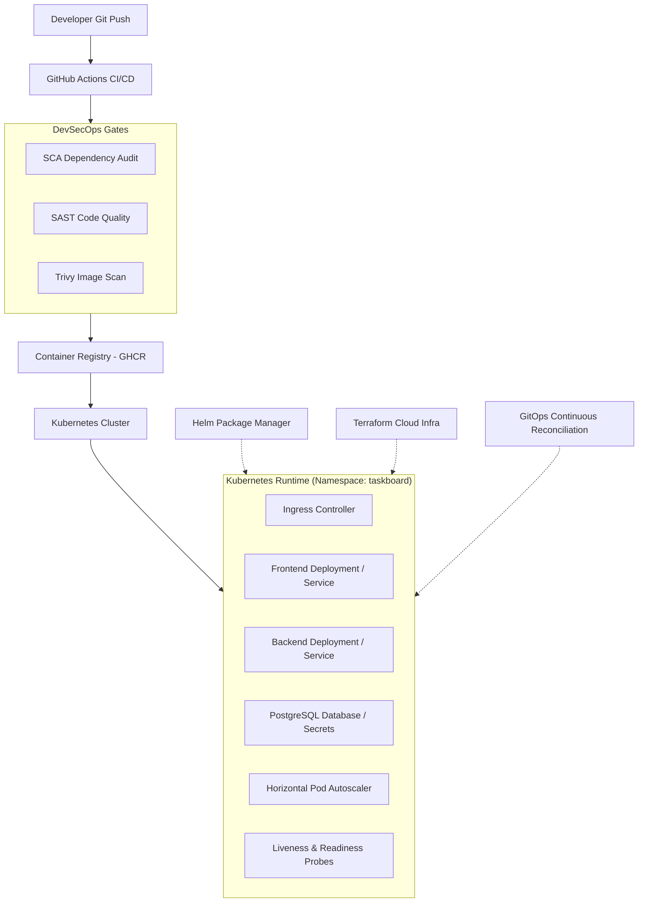
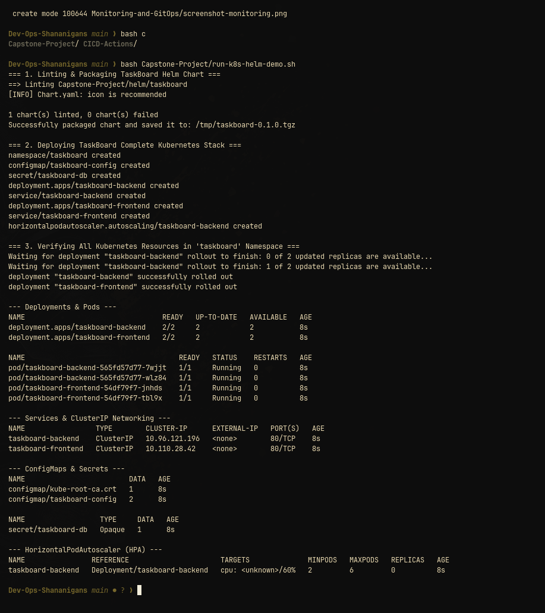
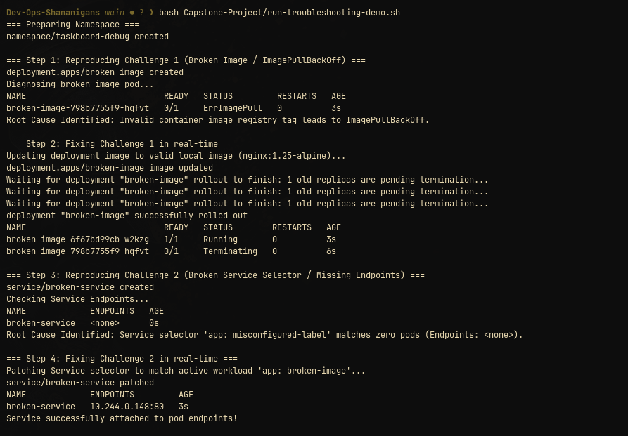

# Session 21: Final DevOps Project & Troubleshooting

## 1. Project Overview & Architecture
TaskBoard is an enterprise-grade cloud-native full-stack application built to demonstrate an end-to-end DevOps and DevSecOps lifecycle from code commit to automated Kubernetes operations.

---

## 2. Technologies Used
- **Compute & Containers:** Docker, Python 3.12 (FastAPI), React (Vite), NGINX
- **Orchestration & Packaging:** Kubernetes (Minikube), Helm v3
- **Infrastructure as Code:** Terraform (AWS VPC, Subnets, EC2, S3)
- **CI/CD & Security:** GitHub Actions, Trivy Security Scanner, Bandit/Safety, Non-root containers
- **Observability & GitOps:** Kubernetes Metrics-Server, Prometheus/Grafana, Declarative GitOps reconciliation

---

## 3. Kubernetes, Helm & Workload Deployments
The application utilizes declarative Kubernetes manifests and a Helm chart located in `helm/taskboard`:
- **Deployments & Pods:** Multi-replica scalable deployments for backend and frontend.
- **Networking:** Dedicated ClusterIP services for backend and frontend communication.
- **Configuration & Security:** Decoupled ConfigMaps (`taskboard-config`) and opaque Secrets (`taskboard-db`).
- **Autoscaling & Reliability:** Horizontal Pod Autoscaler (`minReplicas: 2`, `maxReplicas: 6`, `targetCPU: 60%`) and health probes.

### Verification Screenshot:

---

## 4. Final Troubleshooting Challenge
To demonstrate root cause analysis and resolution workflows:
1. **Challenge 1 (ImagePullBackOff / ErrImagePull):**
   - *Symptom:* Pod stuck in `ErrImagePull` due to invalid image tag `example.invalid/taskboard:nonexistent-tag`.
   - *Investigation:* `kubectl describe pod` identified the failure to pull the image from the registry.
   - *Resolution:* Patched container image to a verified existing image (`nginx:1.25-alpine`) via `kubectl set image`.
2. **Challenge 2 (Service Selector Misconfiguration):**
   - *Symptom:* `kubectl get endpoints broken-service` reported `<none>`.
   - *Investigation:* Compared service selector (`app: misconfigured-label`) against pod labels (`app: broken-image`).
   - *Resolution:* Patched service selector to match active pod labels via `kubectl patch service`.

### Verification Screenshot:

---

## 5. Lessons Learned
- **Security in Pipeline:** Implementing early DevSecOps gates (Trivy, non-root users) prevents runtime container escalations.
- **Declarative Operations:** GitOps workflows eliminate manual cluster drift and enable rapid disaster recovery.
- **Observability:** Health probes coupled with metrics-server enable automated zero-downtime rolling updates and autonomous scaling.
