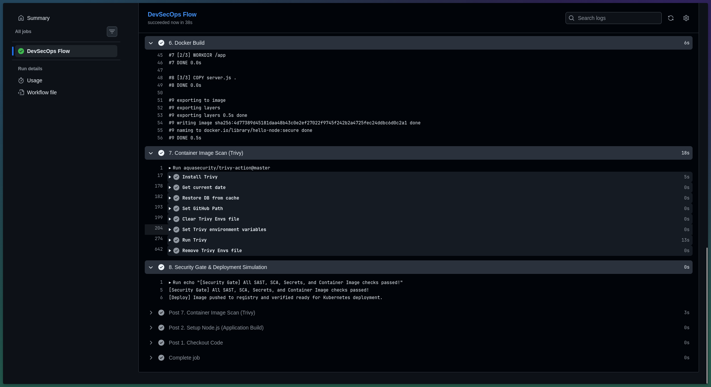

# Session 17: Complete CI/CD & DevSecOps Pipeline

This project implements an end-to-end DevSecOps pipeline embedding automated security gates at every stage of the software delivery lifecycle.

---

## 1. DevSecOps Architecture & Stages

```text
Code ➔ Build ➔ Unit Test ➔ SAST ➔ SCA ➔ Secret Scan ➔ Docker Build ➔ Container Scan ➔ Security Gate ➔ Deploy
```

| Security Stage | Tool / Technique | Purpose |
|---|---|---|
| **SAST** (Static Application Security Testing) | CodeQL / Semgrep / Static Analysis | Analyzes source code for unsafe patterns and vulnerabilities before execution. |
| **SCA** (Software Composition Analysis) | `npm audit` / Trivy fs / Snyk | Detects known vulnerabilities (CVEs) in open-source third-party dependencies. |
| **Secret Scanning** | Gitleaks / Regex Scanner | Prevents credentials, API tokens, and SSH keys from being committed to Git. |
| **Container Image Scanning** | Aqua Security Trivy | Scans base OS layers and container packages for HIGH/CRITICAL vulnerabilities. |
| **Security Gates** | Pipeline Exit Codes | Blocks build and deployment if vulnerabilities exceed security thresholds. |

---

## 2. GitHub Actions Workflow

The automated pipeline is defined in [`.github/workflows/devsecops.yml`](../.github/workflows/devsecops.yml):
1. **Application Build & Setup**
2. **SCA Dependency Audit**
3. **SAST Code Pattern Verification**
4. **Secret Scanning Check**
5. **Docker Image Build**
6. **Trivy Container Image Scan**
7. **Security Gate & Deployment Gate**

---

## 3. Pipeline Execution & Verification Screenshots

### End-to-End DevSecOps Stages (SCA, SAST, Secret Scanning)


Demonstrates automated execution of:
- **3. SCA - Dependency Vulnerability Scan** (`npm audit`)
- **4. SAST - Static Code Analysis** (pattern and code vulnerability detection)
- **5. Secret Scanning** (detecting leaked credentials/tokens)

### Container Build, Trivy Security Scan & Security Gate


Demonstrates:
- **6. Docker Build** of `hello-node:secure`
- **7. Container Image Scan** via Aqua Security Trivy (identifying CVE vulnerabilities)
- **8. Security Gate & Deployment Simulation** verifying pipeline gating criteria prior to production deployment.
