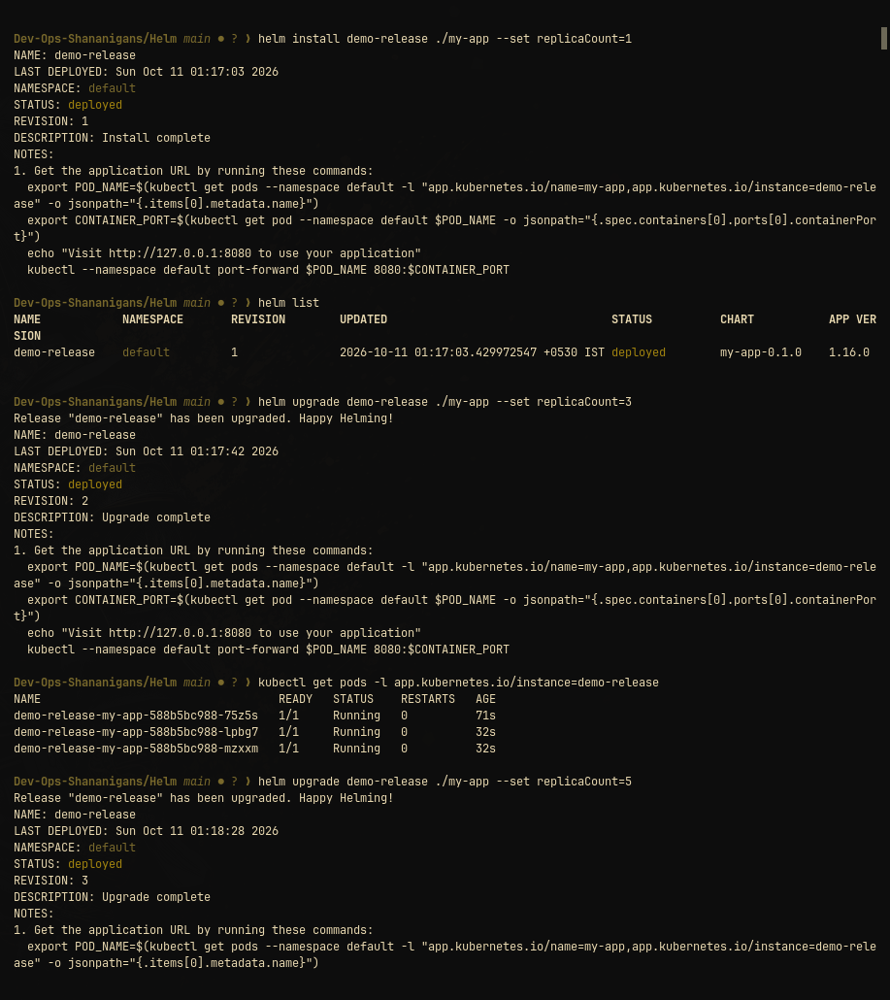

# Helm Package Manager — Complete Lab & Lifecycle Guide

This homework demonstrates packaging, deploying, upgrading, and rolling back applications on Kubernetes using Helm.

---

## 1. Core Helm Commands Reference

| Command | Purpose |
|---|---|
| `helm create <chart-name>` | Scaffolds a new chart with standard templates and values.yaml |
| `helm install <release-name> <chart-path>` | Deploys a chart release onto Kubernetes |
| `helm list` | Lists all deployed releases in the current namespace |
| `helm status <release-name>` | Displays current release status, notes, and deployed resources |
| `helm get values <release-name>` | Inspects the custom values applied to a release |
| `helm upgrade <release-name> <chart-path>` | Updates a running release with modified chart templates/values |
| `helm history <release-name>` | Shows revision history and changelog of a release |
| `helm rollback <release-name> <revision>` | Instantly reverts a release to a previous revision |
| `helm uninstall <release-name>` | Deletes the release and purges its Kubernetes resources |
| `helm repo add / list` | Manages remote Helm chart repositories |
| `helm search repo <keyword>` | Searches remote chart repositories for packages |

---

## 2. Helm Lifecycle & Rollback Workflow

```text
Install (Rev 1: 1 replica)
   ↓
Upgrade (Rev 2: 3 replicas)
   ↓
Upgrade Again (Rev 3: 5 replicas)
   ↓
Rollback (Revert to Rev 1: back to 1 replica)
   ↓
Verify (History shows Revision 4 rolled back to Rev 1)
```

---

## 3. Hands-on Verification Screenshots

### Helm Install & Upgrade Lifecycle


Demonstrates initial installation of `demo-release` at Revision 1 with 1 replica, followed by upgrades to Revision 2 (3 replicas) and Revision 3 (5 replicas).

### Helm Rollback & Verification


Demonstrates executing `helm rollback demo-release 1`, creating Revision 4 (marked with description `Rollback to 1`), and the pods immediately scaling back down to a single replica (`demo-release-my-app-...-mzxxm`).
