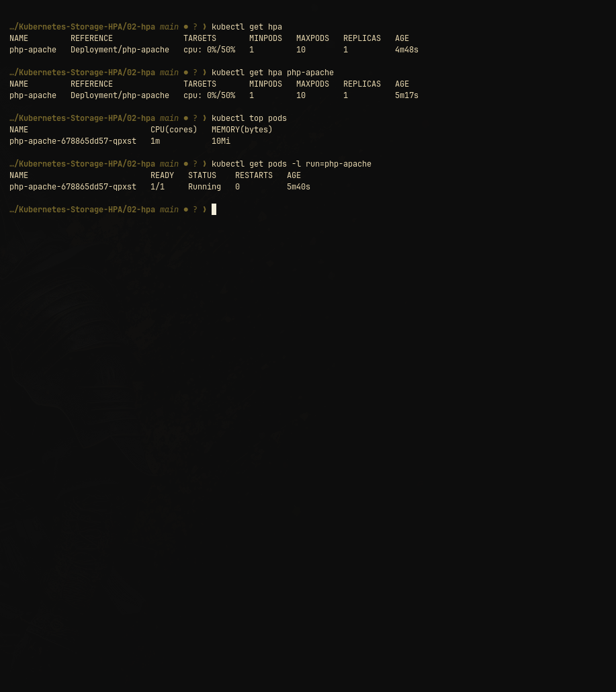

# Kubernetes Horizontal Pod Autoscaler (HPA)

This hands-on demonstrates automatic horizontal scaling of Pods based on CPU utilization metrics.

---

## Architecture & Workflow
1. **Metrics Server:** Collects CPU/memory metrics from kubelets via the Metrics API.
2. **HPA Controller:** Periodically checks average CPU utilization against the target (50%).
3. **Scaling:** When CPU load exceeds 50%, HPA automatically scales up the deployment replicas (up to max 10). When traffic subsides, HPA scales replicas back down to min (1).

---

## Manifest (`hpa.yaml`)
- Deployment: `php-apache` with CPU requests (`200m`) and limits (`500m`).
- Service: `php-apache` exposing port 80.
- HorizontalPodAutoscaler: targets 50% average CPU utilization, min 1 replica, max 10 replicas.

---

## Hands-on Execution Steps

### 1. Deploy the Application & HPA
```bash
kubectl apply -f hpa.yaml
kubectl get hpa
kubectl get pods
```

### 2. Run the Load Generator
Run a busybox container generating continuous HTTP requests:
```bash
kubectl run -i --tty load-generator --rm --image=busybox:latest --restart=Never -- /bin/sh -c "while sleep 0.01; do wget -q -O- http://php-apache; done"
```

### 3. Observe CPU Utilization and Pod Scaling
In a separate terminal:
```bash
kubectl get hpa php-apache -w
kubectl top pods
kubectl get pods -l run=php-apache
```

### 4. Stop Load Generator & Observe Scale Down
Terminate the load generator (`Ctrl+C`). After the cooldown period (default ~5 minutes), HPA scales the deployment back down to 1 replica.

---

## Verification Screenshot



Shows `php-apache` HPA successfully registered with `metrics-server`, querying targets `0%/50%`, with current replica count `1`, and `kubectl top pods` reporting accurate CPU and memory usage (`1m / 10Mi`).
