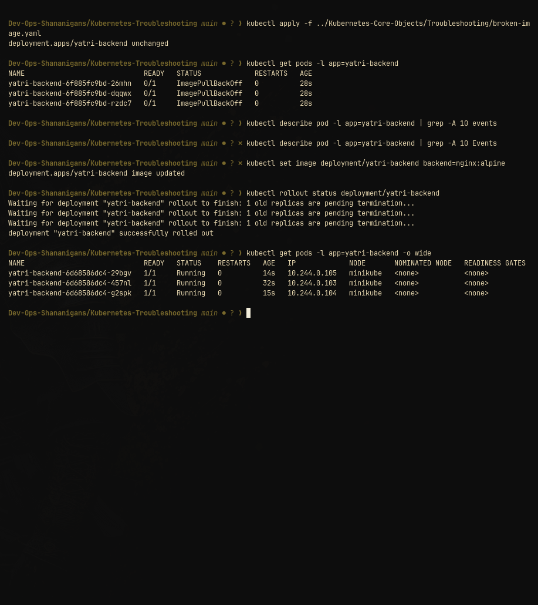

# Kubernetes Troubleshooting Master Guide

This guide covers real-world troubleshooting workflows, essential diagnostic commands, and debugging scenarios for common Kubernetes failure states.

---

## 1. Essential Diagnostic Commands Reference

| Command | Purpose |
|---|---|
| `kubectl get pods -o wide` | Check Pod status, ready counts, restarts, node placement, and Pod IPs |
| `kubectl describe pod <name>` | Inspect Pod events, lifecycle state, probe failures, and image pull errors |
| `kubectl logs <name> [-p]` | View container stdout/stderr logs (`-p` views logs of previous crashed instance) |
| `kubectl exec -it <name> -- <cmd>` | Execute diagnostic commands (ping, curl, nslookup, env) directly in a container |
| `kubectl events --sort-by='.metadata.creationTimestamp'` | Stream cluster-wide events chronologically |
| `kubectl explain <resource>.<field>` | Documentation and syntax schema for any manifest field |
| `kubectl top pods / nodes` | Real-time CPU and memory utilization |

---

## 2. Common Kubernetes Failure Scenarios & Solutions

### Scenario A: `ImagePullBackOff` / `ErrImagePull`
- **Root Cause:** Typo in image name/tag, private registry authentication missing (`imagePullSecrets`), or registry DNS unreachable.
- **Investigation:** `kubectl describe pod <pod-name>` -> check `Events` at the bottom.
- **Resolution:** Correct the image tag in the manifest or preload image into cluster.

### Scenario B: `CrashLoopBackOff`
- **Root Cause:** Container process exits with a non-zero exit code immediately upon startup (missing config file, misconfigured command, unhandled exception).
- **Investigation:** `kubectl logs <pod-name>` or `kubectl logs <pod-name> --previous`.
- **Resolution:** Fix startup parameters or application configuration.

### Scenario C: Selector Mismatch (`selector-error-demo`)
- **Root Cause:** `spec.selector.matchLabels` does not match `spec.template.metadata.labels`.
- **Investigation:** `kubectl apply` returns an immediate validation error from the API server:  
  `The Deployment "..." is invalid: spec.template.metadata.labels: Invalid value: ...: `does not match selector`.
- **Resolution:** Ensure template labels strictly match selector labels.

### Scenario D: Service Connectivity & Empty Endpoints
- **Root Cause:** Service selector does not match running pod labels, causing endpoints list to be `<none>`.
- **Investigation:** `kubectl get endpoints <service-name>`.
- **Resolution:** Match Service `spec.selector` with Pod labels.

---

## 3. Hands-on Troubleshooting Verification

### Verification Screenshot

Demonstrates root-cause investigation of `ImagePullBackOff` failure, deploying an in-place container image fix using `kubectl set image deployment/yatri-backend backend=nginx:alpine`, and verifying rollout recovery with all 3 replicas restored to `Running (1/1)` state.
