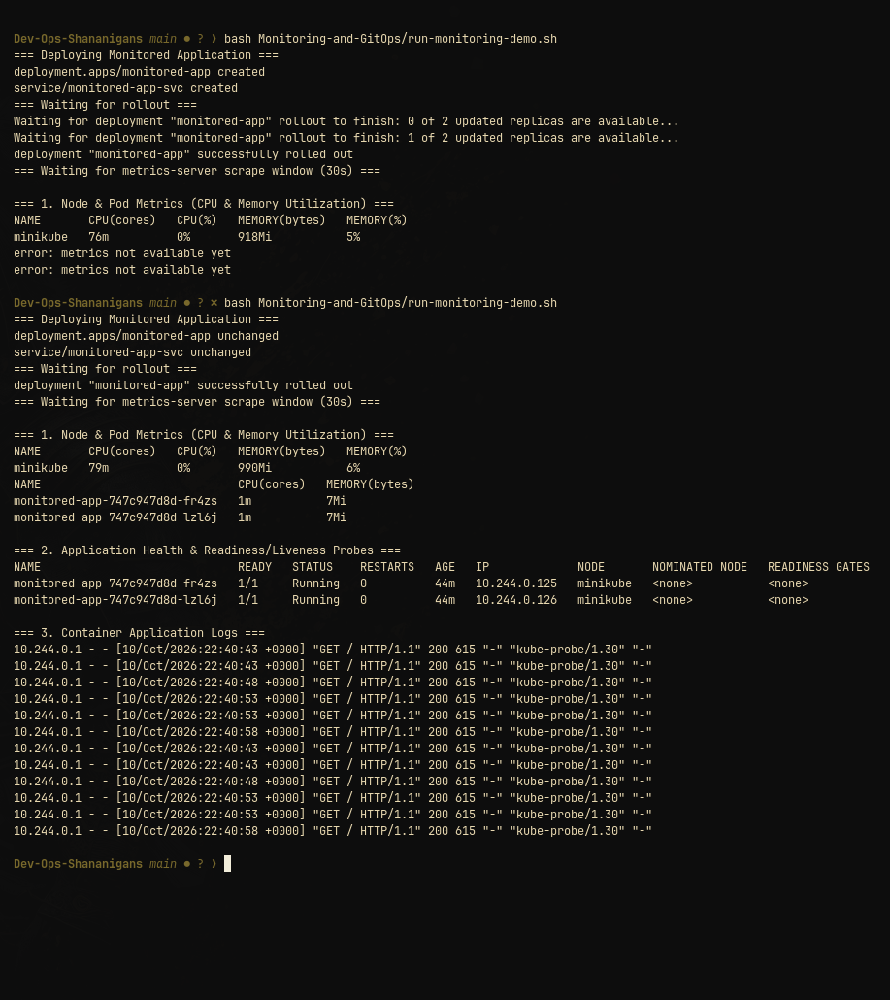
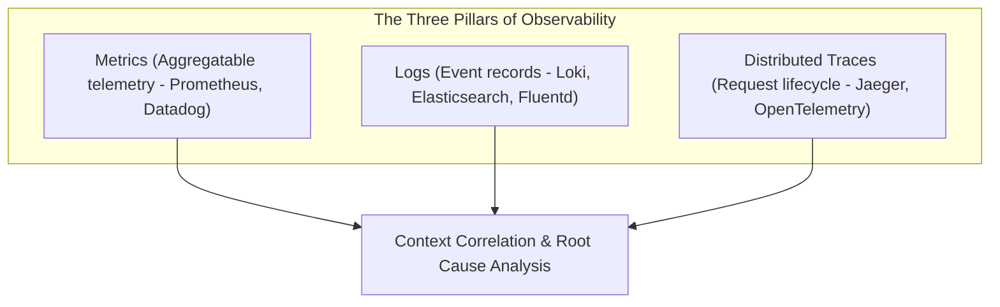
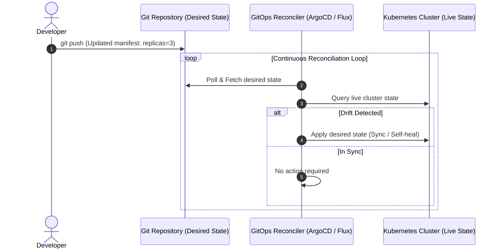
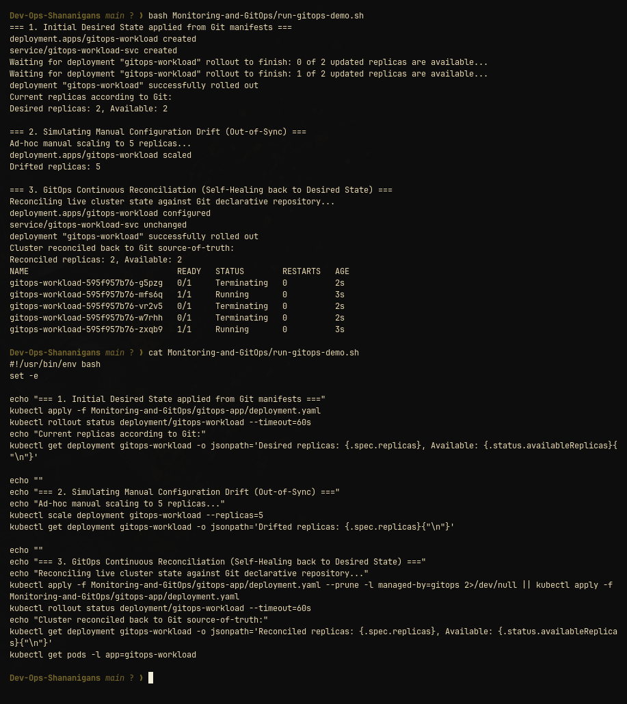

# Session 20: Monitoring, Observability & GitOps

This repository covers the complete architecture, concepts, and hands-on demonstrations for **Monitoring**, **Observability (Three Pillars)**, and **GitOps continuous reconciliation**.

---

## 1. Task 1: Monitoring Architecture & Demo

### Core Concepts:
- **Metrics:** Numerical values sampled over time (CPU utilization, memory usage, request counts, latencies).
- **Logs:** Time-stamped discrete text records describing exact events that occurred within application containers or system components.
- **Alerts:** Automated notifications fired when specific rule thresholds are exceeded (e.g., CPU > 80% for 5 mins).
- **Application Health:** Readiness & Liveness probes continuously evaluating pod health and triggering self-healing restarts.

### Verification Screenshot:

---

## 2. Task 2: Observability Architecture & The Three Pillars

Observability is the degree to which the internal states of a system can be inferred from its external outputs (Telemetry).

### Deep Dive into the Three Pillars:
1. **Metrics:**
   - Aggregatable numbers representing system and application state.
   - Ideal for alerting and dashboards (low storage overhead).
   - Standard formats: Prometheus Exposition Format, OpenTelemetry metrics.
2. **Logs:**
   - Event-driven textual data containing stack traces, request details, and contextual attributes.
   - Indispensable for post-incident forensics and debugging exact edge cases.
3. **Traces:**
   - Follows the execution path of an individual transaction through a distributed microservices network.
   - Instruments span IDs, parent IDs, duration, and contextual metadata to isolate microservice latency bottlenecks.

### Why Observability is Required in Modern Cloud-Native Systems:
- Ephemeral containers come and go dynamically; debugging inside a stopped container is impossible without externalized telemetry.
- Microservices distribute single requests across dozens of services; logs alone cannot establish inter-service causality without distributed tracing.

---

## 3. Task 3: GitOps Workflow & Continuous Reconciliation

GitOps is an operational framework that uses Git repositories as the single source of truth for infrastructure and application code.

### Key Principles of GitOps:
1. **Declarative Descriptions:** The entire desired system state is defined declaratively (YAML / Kustomize / Helm).
2. **Versioned Single Source of Truth:** Stored in Git with auditability, pull-request review gates, and instant rollback via `git revert`.
3. **Automated Pull Reconciliation:** An in-cluster operator actively pulls changes and continuously reconciles any configuration drift.

### Verification Screenshot:

