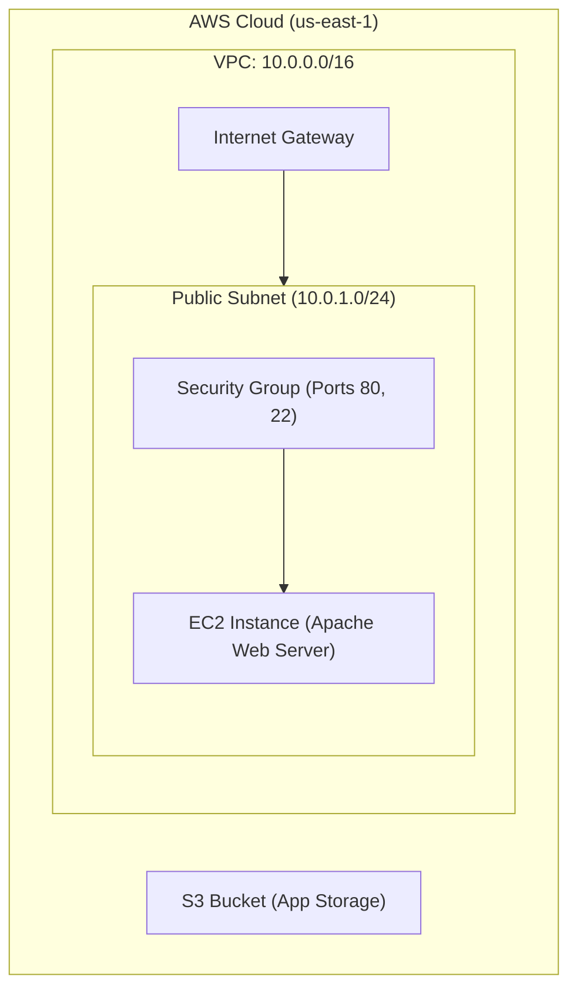
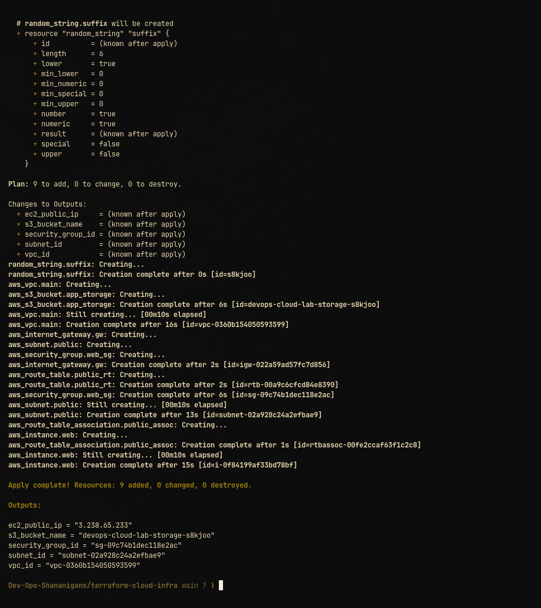

# Session 19: End-to-End Cloud Infrastructure with Terraform

This project provisions complete AWS cloud networking, compute, and storage infrastructure using Terraform.

---

## 1. Architecture Diagram

---

## 2. Resources Provisioned

- **VPC & Networking:** Custom VPC (`10.0.0.0/16`), Internet Gateway, Public Subnet (`10.0.1.0/24`), Route Table & Associations.
- **Security Group:** Stateful firewall allowing inbound port 80 (HTTP) and port 22 (SSH).
- **EC2 Instance:** `t3.micro` running Amazon Linux 2023 with Apache installed via `user_data`.
- **S3 Bucket:** Dedicated storage bucket with randomized suffix.

---

## 3. Execution Lifecycle & Verification Screenshots

All 9 cloud resources (VPC, Subnet, Route Table, Internet Gateway, Security Group, EC2 Instance, S3 Bucket, and Random Suffix) provisioned cleanly with expected outputs and subsequently torn down via `terraform destroy`.
