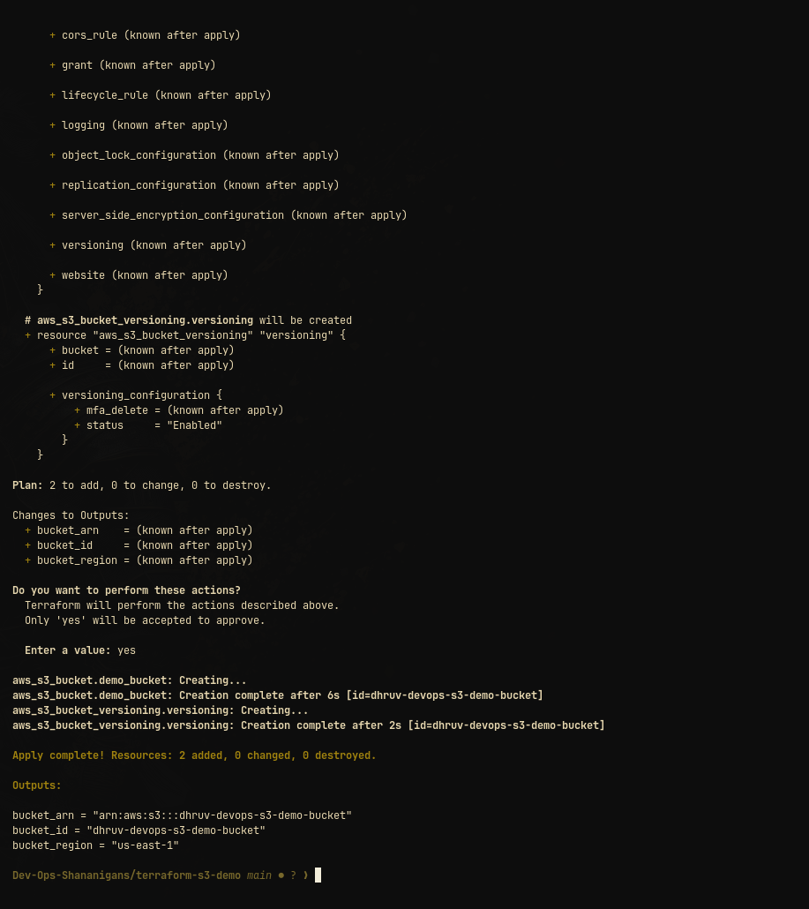

# AWS S3 Bucket Provisioning with Terraform

This project demonstrates declarative infrastructure provisioning using Terraform to create and manage an AWS S3 bucket.

---

## 1. Project Directory Layout
```text
terraform-s3-demo/
├── main.tf           # S3 bucket and versioning resource definitions
├── variables.tf      # Input variable declarations
├── outputs.tf        # Exported resource attributes (bucket ID, ARN, Region)
├── provider.tf       # AWS provider configuration and version constraints
├── terraform.tfvars  # Variable values
└── README.md         # Documentation and execution lifecycle
```

---

## 2. Terraform Lifecycle Commands

| Command | Action |
|---|---|
| `terraform init` | Initializes working directory, downloads AWS provider plugins |
| `terraform fmt` | Formats configuration files according to canonical style conventions |
| `terraform validate` | Validates syntax, attribute arguments, and variable consistency |
| `terraform plan` | Generates and reviews an execution plan showing changes before applying |
| `terraform apply` | Creates and configures the S3 bucket in AWS |
| `terraform show` | Inspects current state representation in human-readable format |
| `terraform output` | Queries and prints exported output values |
| `terraform destroy` | Safely tears down and deletes all resources managed by this configuration |

---

## 3. Hands-on Execution Verification

### Terraform Apply & Resource Creation


Demonstrates `terraform apply` successfully creating `aws_s3_bucket.demo_bucket` (`dhruv-devops-s3-demo-bucket`) and `aws_s3_bucket_versioning.versioning` with `status = "Enabled"`, reporting `2 added, 0 changed, 0 destroyed` along with exported outputs.

### Terraform Outputs & State Verification


Demonstrates querying exported resource attributes via `terraform output`:
- `bucket_arn`: `arn:aws:s3:::dhruv-devops-s3-demo-bucket`
- `bucket_id`: `dhruv-devops-s3-demo-bucket`
- `bucket_region`: `us-east-1`
